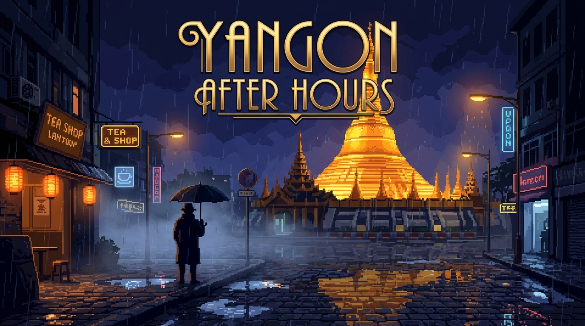

# Yangon After Hours (ရန်ကုန်ညဉ့်နက်ချိန်)



A 2D point-and-click pixel-art mystery puzzle adventure set in the rain-slicked streets, tea shops, and night markets of Yangon, Myanmar. Built with **Godot 4.x** and **GDScript**, designed for desktop and mobile touch input, targeting web (HTML5) and standalone export.

---

## 🌃 Overview

Step into the shoes of a detective navigating Yangon's humid midnight shadows under neon reflections and golden pagoda spires:

- **Interactive City Map**: Navigate between Downtown (Sule Pagoda), Lucky Tea Shop (38th Street), and the Night Market (Strand Road Waterfront).
- **Interactive Character Questioning & Evidence Presentation**: Question important characters with interactive subject menus, revisit past topics, and present notebook clues to expose contradictions and uncover hidden testimonies.
- **Detective Investigation Board & Deduction System**: Interactive workbench allowing players to connect gathered clues and synthesize game-changing deductions.
- **Close-up Object Inspection System**: Examine key crime-scene objects up close (Leather Notebook, Crumpled Receipt, Antique Wall Clock) with clickable detail hotspots and real-time clue recording.
- **Three-Part Mystery Puzzle Arc**:
  - *Lucky Tea Shop Order Puzzle*: Deduce and serve the exact traditional tea orders (`Cho-seint`, `Cho-pyit`, `Pawt-seint`) for Table 3 patrons.
  - *Vendor's Missing Notebook Puzzle*: Align tumbler combination dials to crack open Ko Lin's iron spice chest at the market.
  - *Final Heritage Delivery Puzzle*: Synthesize the harbor manifest seal, secret ledger passcode, and authorized sentry to secure the royal relics.
- **Full Bilingual Localization (English & မြန်မာစာ)**: Seamless one-click language switching across all menus, dialogue, notebooks, and puzzles using the embedded `Pyidaungsu` font.
- **Web (HTML5) & Mobile Touch Ready**: Configured for single-threaded Web export (itch.io / GitHub Pages compatible) with responsive mouse and touch input.

---

## 👥 Characters & Cast

- **Tea Master Ko Zaw** — Lucky Tea Shop counter master whose initial testimony hides a critical timeline contradiction.
- **Night Watchman U Ba** — Sentry guarding colonial banks near Sule Pagoda.
- **Street Food Cook Ko Lin** — Sizzling grill vendor at Strand Road Night Market whose locked chest holds vital evidence.
- **Saya Min (The Teacher)** — Grading exams late into the night, needs bold caffeine (`Cho-pyit`).
- **Ma Thida (The Trader)** — Haggling all day at the harbor, craves sweet and rich tea (`Cho-seint`).
- **Ko Aung (The Driver)** — Midnight taxi driver, prefers low-sugar, creamy brew (`Pawt-seint`).

---

## 🛠️ Project Structure

```text
yangon-after-hours/
├── assets/
│   ├── avatars/             # Character portrait sprites (transparent PNG with outlines)
│   ├── fonts/               # Pyidaungsu.ttf Burmese Unicode font
│   ├── inspect/             # Close-up inspection textures (notebook, receipt, clock)
│   ├── locations/           # Location backgrounds (Downtown, Tea Shop, Market)
│   ├── map/                 # Stylized Yangon city map
│   └── ui/                  # Cover artwork and application icons
│       ├── game_cover.png   # 16:9 Landscape cover artwork
│       └── game_icon.png    # 512x512 Square app icon
├── scenes/
│   ├── main_menu.tscn       # Main title screen with Play & Language toggles
│   ├── city_map.tscn        # City navigation map with district preview
│   ├── game_ending.tscn     # Epilogue and case summary with statistics
│   ├── components/
│   │   ├── dialogue_panel.tscn         # Cinematic dialogue & interrogation UI
│   │   ├── inspection_panel.tscn       # Zoomed-in object inspection overlay
│   │   ├── notebook_panel.tscn         # Clue cards & deduction synthesis workbench
│   │   ├── tea_puzzle_panel.tscn       # Burmese tea matching puzzle
│   │   ├── market_puzzle_panel.tscn    # Vendor combination tumbler puzzle
│   │   └── delivery_puzzle_panel.tscn  # Heritage vault delivery puzzle
│   └── locations/
│       ├── downtown.tscn    # Downtown Sule scene & delivery gate
│       ├── tea_shop.tscn    # Lucky Tea Shop & interrogation scene
│       └── market.tscn      # Strand Road Night Market scene
├── scripts/
│   ├── game_state.gd        # Autoload singleton (clues, deductions, state persistence)
│   ├── localization.gd      # Bilingual dictionary (EN & Myanmar)
│   ├── interactable_hotspot.gd # Point-and-click hotspot component
│   ├── dialogue_panel.gd    # Interrogation, typewriter & choices controller
│   ├── inspection_panel.gd  # Object inspection controller
│   ├── notebook_panel.gd    # Investigation board controller
│   ├── location_scene.gd    # Base district location controller
│   └── test_*.gd            # Headless automated test suites
├── export_presets.cfg       # Single-threaded Web (HTML5) export preset
└── project.godot            # Godot 4.x project configuration
```

---

## 🚀 Running the Game

1. Download or clone this repository.
2. Open **Godot Engine 4.x** (v4.2+ recommended).
3. Import the project using `project.godot`.
4. Press **F5** (or click **Play**) to start from `res://scenes/main_menu.tscn`.

### Controls
- **Mouse / Touch**: Tap or click hotspots, map pins, notebook cards, and dialogue choices.
- **Space / Enter**: Advance dialogue.
- **Escape**: Close open dialogue, inspection, or notebook panels.

---

## 🧪 Automated Tests

Run the test suites headless using the Godot console executable:

```powershell
godot --headless -s "res://scripts/test_questioning_system.gd"
godot --headless -s "res://scripts/test_deduction_board.gd"
godot --headless -s "res://scripts/test_inspection_system.gd"
godot --headless -s "res://scripts/test_tea_puzzle.gd"
godot --headless -s "res://scripts/test_market_puzzle.gd"
godot --headless -s "res://scripts/test_interactions.gd"
godot --headless -s "res://scripts/test_localization.gd"
godot --headless -s "res://scripts/test_clue_system.gd"
```
